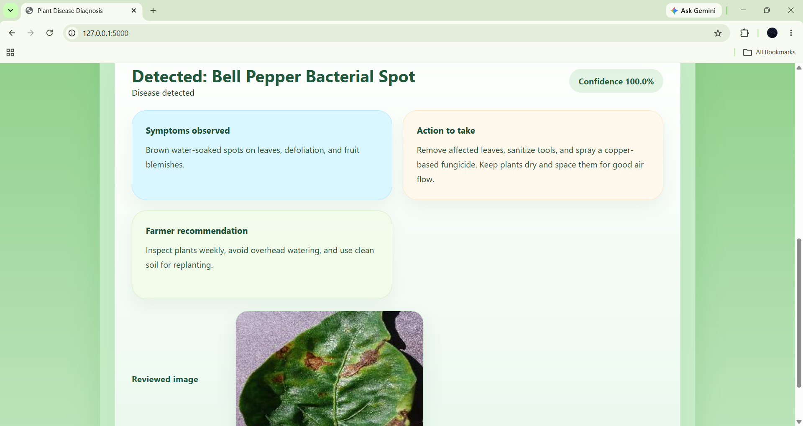

# Plant Disease Diagnosis System

An AI-powered plant disease diagnosis application that uses deep learning and image processing to identify plant diseases from leaf images. The system provides disease information and recommended solutions through a simple, multilingual interface.

## Application Screenshots


## Features

- **AI-Based Disease Detection:** Identifies plant diseases from uploaded leaf images.
- **Multilingual Interface:** Supports English, Hindi, Urdu, and Kannada.
- **Disease Information:** Provides information about identified diseases.
- **Suggested Solutions:** Displays relevant recommendations for detected diseases.
- **Interactive Interface:** Provides a simple and accessible user experience.

## Technology Stack

- Python
- TensorFlow / Keras
- Deep Learning
- HTML, CSS, JavaScript
- Jupyter Notebook

## Project Structure

```text
Plant Disease Diagnosis/
├── app/
│   ├── static/
│   ├── templates/
│   ├── app.py
│   └── disease_solutions.py
├── data/
├── frontend/
├── models/
├── notebooks/
├── src/
│   ├── data_loader.py
│   ├── evaluate.py
│   ├── model.keras
│   ├── model.py
│   ├── predict.py
│   └── train.py
├── .gitignore
└── README.md
```

## System Workflow

1. Upload a plant leaf image.
2. Process the image for model prediction.
3. Analyse the image using the trained deep learning model.
4. Generate the predicted disease class.
5. Display disease information and suggested solutions.
6. Access the application in the preferred language.

## Supported Languages

| Language | |
|---|---|
| English | ✓ |
| Hindi | ✓ |
| Urdu | ✓ |
| Kannada | ✓ |

## Installation

```bash
git clone YOUR_REPOSITORY_URL
cd "Plant Disease Diagnosis"

python -m venv .venv
.venv\Scripts\activate

pip install -r requirements.txt
```

## Run the Application

```bash
python app/app.py
```

## Author

Syeda Rana Manal

[GitHub Profile](https://github.com/syedamanals86-debug)

[Linkdin Profile](https://www.linkedin.com/in/syeda-rana-manal-2bb3a240b/)


